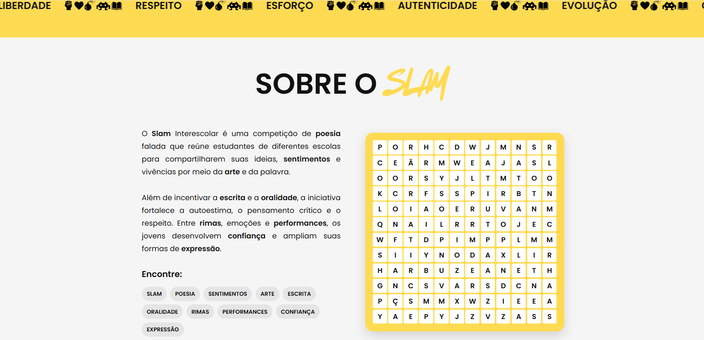
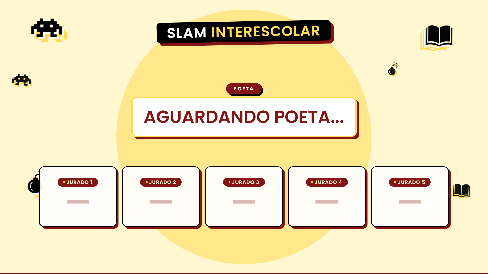

# Projeto SlamEtecamp
Desenvolvimento de um sistema web para apoiar a organização do evento Slam Interescolar na ETEC de Campo Limpo Paulista.
 
 
 
## Descrição 
O Slam Interescolar da ETEC de Campo Limpo Paulista (ETECAMP) é uma competição de poesia falada cuja organização enfrenta dificuldades no gerenciamento das inscrições, no controle das etapas, no registro das pontuações e na divulgação das informações. Essas atividades eram realizadas de forma manual, o que pode ocasionar erros e perda de informações.
 
Diante disso, desenvolveu-se o sistema web Slam ETECAMP, que centraliza as informações do evento e automatiza processos específicos. A plataforma reúne três perfis de usuário: o Organizador, que gerencia eventos, inscrições, mural, galeria e regulamento; o Aluno, que consulta as informações e se inscreve, assumindo o papel de poeta; e o Matemático, que registra as notas dos jurados e calcula automaticamente a pontuação final. Dessa forma, o sistema poderá contribuir para uma organização mais eficiente, transparente e acessível do evento.
 
## Equipe 
- Carolina Spinella de Macedo — Back-end 
- Emily Aparecida da Silva Menegon — Front-end 
- Nathalia Genuino Borges — Documentação 
 
## Tecnologias Utilizadas  
- HTML (5), CSS (3), JavaScript (ES2022)
- React (18.2) e Vite (8)
- Node.js (22) e Express (5.2)
- SQLite (3)
 ## Algumas imagens para demostrar o site desenvolvido
 
 
 
 
 
## Como executar o projeto (passo-a-passo) 
 
> **Atenção:** o backend e o site precisam estar rodando ao mesmo tempo. O `npm install` só precisa ser feito na primeira vez.
 
### Passo 1: Preparar o projeto
 
1. Extrair o arquivo zip;
2. Entrar no editor de código (exemplo: VS Code);
3. Abrir a pasta `SlamEtecamp-main` extraída (Arquivo → Abrir Pasta).
### Passo 2: Rodar o backend
 
Abrir o terminal (Terminal → Novo Terminal) e digitar:
 
```bash
cd SlamEtecamp-main
cd backend
npm install
node index.js
```
 
**Não fechar esse terminal.**
 
### Passo 3: Rodar o site
 
Abrir outro terminal (botão + no painel do terminal) e digitar:
 
```bash
cd SlamEtecamp-main
npm install
npm run dev
```
 
### Passo 4: Abrir no navegador
 
1. O terminal vai mostrar um link;
2. Copiar o link e colar no navegador.
## Acesso ao sistema
 
| Perfil | E-mail | Senha |
|---|---|---|
| Organizador | organizador@gmail.com | organizador1234 |
| Matemático | mat@gmail.com | matematico1234 |
 
## Como citar o projeto  
 
SPINELLA, Carolina; MENEGON, Emily; BORGES, Nathalia. Desenvolvimento de um sistema web para apoiar a organização do evento Slam Interescolar na ETEC de Campo Limpo Paulista. 2026. 52 p. 
 
Em caso de dúvidas entre em contato com eminathicaroltcc@gmail.com 
 
Para acessar o trabalho escrito do projeto: https://ric.cps.sp.gov.br/ 
